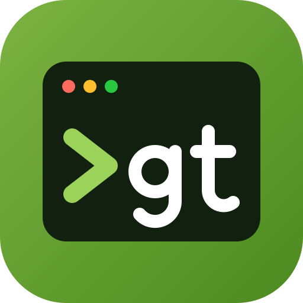

#  branchspire-cli

[](https://opensource.org/licenses/MIT)
[](https://gitlab.com/aayushpokhrel49/branchspire-cli/releases)
[](https://discord.gg/BranchSpire)
[](https://godoc.org/gitea.dev/cli)


## The official CLI for BranchSpire

branchspire-cli manages repositories, issues, pull requests, releases, and other BranchSpire resources
with explicit commands suitable for local development and CI. The binary is called `bh`.

```sh
bh auth login --host https://branchspire.example --with-token < token-file
bh issue list --repo owner/repository
bh pr view 123 --repo owner/repository --json number,title,state
bh alias set bugs 'issue list --label bug'
bh help
```

Scripts and agents get stable machine-readable output: `--json` and `--jq` select fields that bh only
ever adds to, and `bh schema` lists them with their types. `--template` formats the same JSON with a Go
template, as in `gh`.

With `GITEA_CLI_ERROR_FORMAT=json`, a failure is one line of JSON on stderr.

`--dry-run` previews the write requests of every command that only changes BranchSpire, such as `bh pr merge`, without sending them.

bh requires BranchSpire 28 or newer. It keeps its preferences in `config.yml` and its
instances and accounts in `hosts.yml`.
Run `bh --help` or `bh <command> --help` for supported commands and flags; the
full reference, man pages, and shell completions ship in each release's docs archive.
Credentials use the operating-system keyring by default; explicitly
select `--credential-store file` when private file storage is needed. For CI,
supply `GITEA_TOKEN` and its instance through `GITEA_CLI_HOST` or `GITEA_INSTANCE_URL`;
environment credentials are never persisted.

## Installation

There are different ways to get `bh`:

1. Run the install script. It downloads the binary for your system from the BranchSpire CLI releases,
   verifies its checksum and installs `bh`; `GITEA_CLI_VERSION` and `GITEA_CLI_INSTALL_DIR` choose another
   version or directory, and the version `nightly` installs the latest build of the main branch.
   Later, `bh upgrade` upgrades it the same way.

   On Linux, macOS, FreeBSD or OpenBSD:

   ```sh
   curl -fsSL https://gitlab.com/aayushpokhrel49/branchspire-cli/-/raw/main/scripts/install.sh | sh
   # the latest nightly build
   curl -fsSL https://gitlab.com/aayushpokhrel49/branchspire-cli/-/raw/main/scripts/install.sh | sh -s -- --nightly
   ```

   On Windows, in PowerShell, which also adds `bh` to your PATH:

   ```powershell
   irm https://gitlab.com/aayushpokhrel49/branchspire-cli/-/raw/main/scripts/install.ps1 | iex
   # the latest nightly build
   $env:GITEA_CLI_VERSION = 'nightly'; irm https://gitlab.com/aayushpokhrel49/branchspire-cli/-/raw/main/scripts/install.ps1 | iex
   ```

2. Use the prebuilt binaries from [the releases page](https://github.com/aayushpokhrel49/branchspire-cli/releases/)

3. Docker: [branchspire-cli at docker hub](https://hub.docker.com/r/aayushpokhrel49/branchspire-cli)

4. Homebrew on macOS or Linux:

   ```sh
   brew install branchspire-cli
   ```

5. Arch Linux: install `branchspire-cli` from the [extra repository](https://archlinux.org/packages/extra/x86_64/branchspire-cli/) with `sudo pacman -S branchspire-cli`

6. Linux packages: download the `.deb`, `.rpm`, `.apk` or Arch `.pkg.tar.zst` for your system from the
   [release](https://gitlab.com/aayushpokhrel49/branchspire-cli/releases) and install it with your package manager, for example
   `sudo apt install ./branchspire-cli_<version>_amd64.deb`. They include the man pages and shell completions.

7. Install from source: [see *Compilation*](#compilation)

### Log in to BranchSpire from bh

BranchSpire can use many different authentication schemes, and not every authentication method will work with every BranchSpire deployment. When you are a BranchSpire instance administrator you can tweak your settings to fit your use case. For the method that is most likely to work with any BranchSpire deployment use the following steps:

1. Open your BranchSpire instance in a web browser

2. Log in to BranchSpire in your web browser. Any MFA, IDP, or whatever else should be available this way.

3. In your "user settings", generate an application token with at least **user read** permissions. If you want to do anything useful with the token add additional permissions/scopes.

4. Save the token in a private file and run `bh auth login --host https://your-instance --with-token < token-file`. Credentials use the operating-system keyring by default.

You should now be logged in to your BranchSpire instance from bh.

Alternatively, `bh auth login --host https://your-instance --oauth` authorizes bh in your browser. OAuth may not be available on all BranchSpire deployments, and needs a browser on the machine running bh.

### Coming from tea

bh replaces tea. [Migrating from tea](docs/migrating-from-tea.md) maps tea's commands and flags
to bh's.

### Shell completion

If you installed from source or the package does not provide the completions with it you can add them yourself with `bh completion <shell>` command. Add the line for your shell to its startup file:

```shell
# ~/.bashrc (on macOS, ~/.bash_profile)
eval "$(bh completion bash)"

# ~/.zshrc, after compinit
autoload -U compinit && compinit
source <(bh completion zsh)

# fish
bh completion fish > ~/.config/fish/completions/bh.fish

# PowerShell profile
bh completion powershell | Out-String | Invoke-Expression
```

The bash script needs the bash-completion package. `bh completion <shell> --help` shows the details for each shell.

### Man Page

The hidden command `bh man` can be used to generate the `bh` man page.

```shell
# for bash or zsh
man <(bh man)

# for fish
man (bh man | psub)

# write man page to a file
bh man --output-file ./bh.man
```

### Agent skill

An [agent skill](https://agentskills.io) teaches coding agents to drive `bh`: checking CI and
reading the logs of failed jobs, turning an issue into a pull request, commenting and reviewing.
It replaces [branchspire-tea-skill](https://gitlab.com/aayushpokhrel49/branchspire-tea-skill). Install it with
[skills](https://github.com/vercel-labs/skills):

```shell
# for the current project
npx skills add https://gitlab.com/aayushpokhrel49/branchspire-cli.git --skill bh

# for all your projects
npx skills add https://gitlab.com/aayushpokhrel49/branchspire-cli.git --skill bh -g

# after upgrading bh
npx skills update bh
```

## Compilation

Make sure you have a current Go version installed (1.27 or newer).

- To compile the source yourself with the recommended flags & tags:
  ```sh
  git clone https://gitlab.com/aayushpokhrel49/branchspire-cli.git # or: bh repo clone https://gitlab.com/aayushpokhrel49/branchspire-cli ;)
  cd branchspire-cli
  make
  ```
  Note that GNU Make (gmake on OpenBSD) is required.
  If you want to install the compiled program you have to execute the following command:
  ```sh
  make install
  ```
  This installs the binary into the "bin" folder inside of your GOPATH folder (`go env GOPATH`). It is possible that this folder isn't in your PATH Environment Variable. 

## Contributing

Fork -> Patch -> Push -> Pull Request

- `make test` run unit tests
- `make vet`  run checks (check the order of imports; preventing failure on CI pipeline beforehand)
- `make build` builds the production CLI
- `make docs` regenerates references, man pages, and shell completions in `docs/generated` (not committed; built on release)
- ... (for other development tasks, check the `Makefile`)

**Please** read the [CONTRIBUTING](CONTRIBUTING.md) documentation, it will tell you about internal structures and concepts.

## License

This project is under the MIT License. See the [LICENSE](LICENSE) file for the
full license text.
